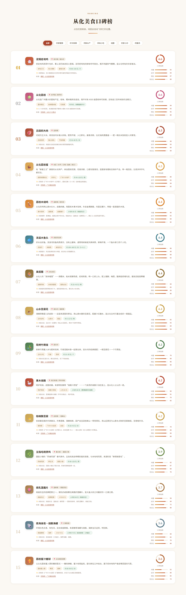
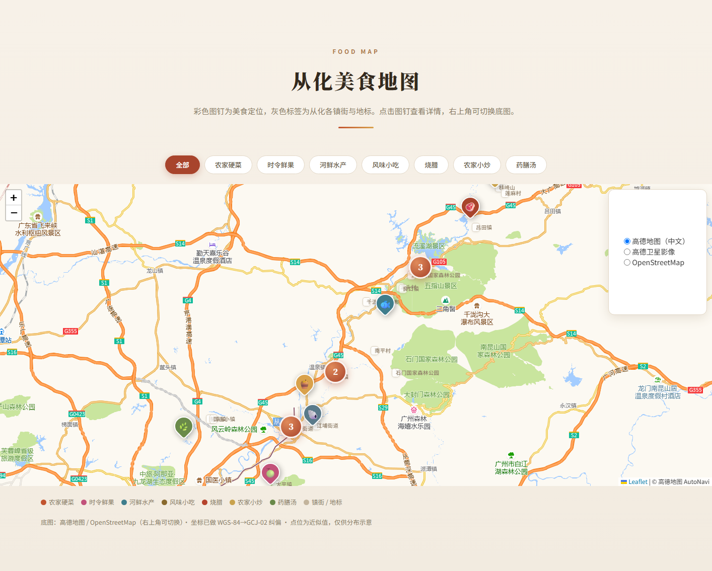
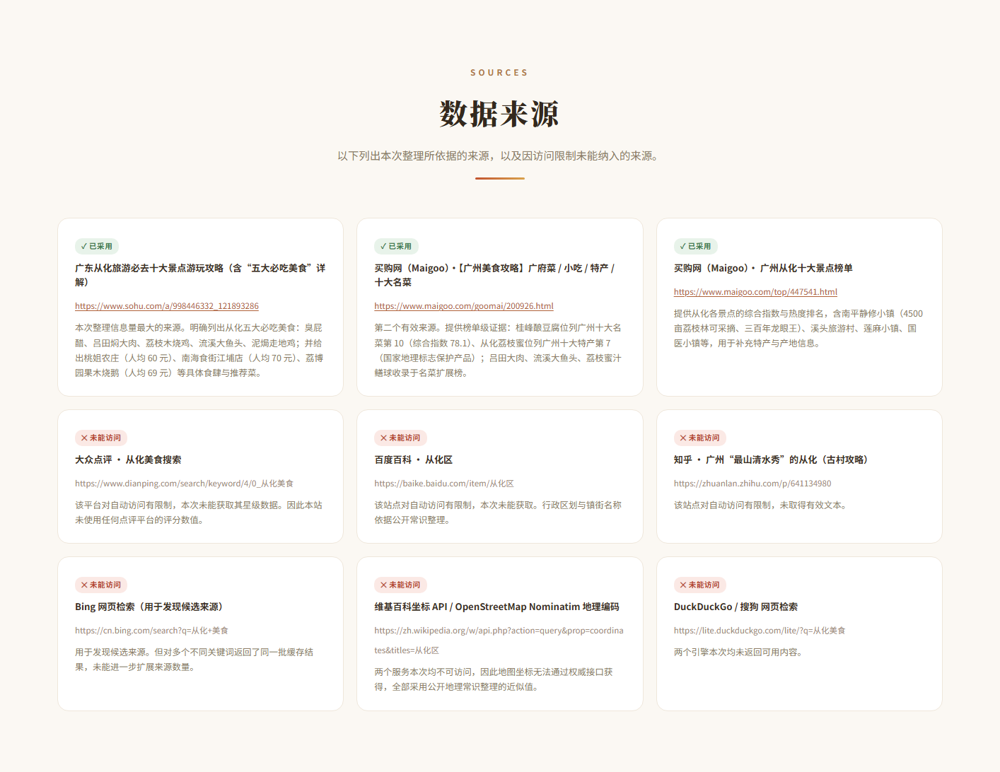

# 寻味从化 · 广州从化美食地图

一个关于**广州市从化区**美食的单文件交互式网站：把散落在网络攻略、榜单与自媒体文章里的从化代表美食，整理成**可复算的评分**并**落到地图上**。

- 形式：纯静态单页，`index.html` 一个文件搞定，无构建步骤
- 规模：15 道美食 · 15 个镇街/地标 · 4 项评分维度 · 9 条来源记录
- 依赖：全部通过 CDN 加载（Leaflet + 高德地图瓦片 + Google Fonts）

---

## 效果预览

| 首页 | 评测方法 |
| --- | --- |
|  |  |

| 美食榜单 | 美食地图 | 数据来源 |
| --- | --- | --- |
|  |  |  |

> 以上为真实页面的分区截图（1440 宽桌面视口），未做任何样式修改。

---

## 一、项目解决什么问题

想去从化吃一趟，实际会碰上三个麻烦：

| 麻烦 | 本项目的处理 |
| --- | --- |
| **不知道吃什么** —— 从化美食信息散落在旅游攻略、榜单、自媒体文章里，说法不一，没有统一视图 | 汇总成 15 道代表美食，按统一的四维度加权打分并排序，给出一个可比较的榜单 |
| **不知道在哪个镇** —— 从化下辖街口、温泉、良口、吕田、太平、鳌头等多个镇街，彼此相距几十公里，"泥焗鸡"到底该去哪吃没有直观概念 | 把每道美食按镇街打点到地图上，空间分布一眼可见；并标注主要道路与景区作为参照 |
| **不知道凭不凭信** —— 网上的"必吃榜"常不说明依据 | 每条美食标注来源链接，评选方法与权重公开可查；未能纳入的来源也一并列出，不掩饰样本局限 |

**一句话**：它回答"去从化吃什么、在哪个镇、大概多少钱、这个结论是哪来的"。

> ⚠️ 项目定位是**信息整理与可视化作品**，不是权威美食指南。评分为本项目按统一维度归纳的**相对口碑指数**，不等同于大众点评等平台的官方评分。详见文末《已知局限》。

---

## 二、主要功能

### 1. 美食口碑榜

15 道美食按综合口碑指数从高到低排列，每条包含：

- **评分环**：0–5 分制综合分
- **四维度评分条**：网络声量 / 口味好评 / 地域特色 / 性价比，各带 0–100 数值
- **参考价格**、**类别标签**、**来源链接**、**一句实用提示**（如"建议 11 点前到避开排队"）

评分公式（代码内可复算）：

```
综合分(100) = 网络声量×0.30 + 口味好评×0.30 + 地域特色×0.25 + 性价比×0.15
综合分(5)   = 综合分(100) / 20，保留一位小数
```

### 2. 分类筛选（榜单与地图联动）

8 个筛选按钮：`全部`、`农家硬菜`、`时令鲜果`、`河鲜水产`、`风味小吃`、`烧腊`、`农家小炒`、`药膳汤`。

榜单区的筛选条与地图区的筛选条**双向同步**：任一处点击，榜单条目高亮/变暗，同时地图只保留对应图钉，并自动缩放到选中范围。

### 3. 交互式美食地图

- **底图**：Leaflet + 高德地图（中文标注）
- **15 个美食图钉**：按类别着色，图标为对应食物 emoji
- **15 个镇街/地标标签**：街口街道、温泉镇、良口镇、吕田镇、太平镇、鳌头镇、江埔街道、流溪河国家森林公园、溪头村、莲麻村、南平村、桂峰山、千泷沟大瀑布、石门国家森林公园、国医小镇
- **标记聚合**：相邻图钉自动合并为数字圆点（聚合半径 46px），缩放到 15 级自动展开
- **点击定位**：点击榜单中任意美食 → 页面滚动至地图 → 自动缩放展开该点位 → 弹出详情气泡

### 4. 底图切换 + 坐标系自动纠偏

右上角可在三种底图间切换：

| 底图 | 坐标系 | 说明 |
| --- | --- | --- |
| 高德地图（中文） | GCJ-02 | 默认，中文标注，国内访问快 |
| 高德卫星影像 | GCJ-02 | 影像底图 |
| OpenStreetMap | WGS-84 | 境外底图 |

**这一点是关键**：项目数据采用 WGS-84（GPS 原始坐标），而高德底图使用 GCJ-02（俗称"火星坐标"），两者在华南相差约 300–500 米。页面渲染前会做 WGS-84 → GCJ-02 转换（内置标准算法，实测偏移约 **北 307m / 东 521m**）；当切换到底图 OpenStreetMap 时会**自动关闭**该转换，避免反向错位。

### 5. 数据来源透明化

页面底部列出本次整理的 **9 条来源**（3 条已采用 / 6 条因访问限制未能纳入），不做选择性展示。

### 6. 其他

- 响应式布局（900px / 640px 两个断点），移动端可用
- 导航锚点平滑滚动
- 滚动超过 600px 显示"回到顶部"按钮

---

## 三、安装方法

**不需要安装。** 项目没有构建步骤、没有包管理器依赖、没有需要编译的源码——全部 HTML / CSS / JavaScript 内联在 `index.html` 中。

### 环境要求

| 项目 | 要求 |
| --- | --- |
| 浏览器 | 任意现代浏览器（Chrome / Edge / Firefox / Safari 均可） |
| 网络 | **需要联网**。Leaflet 库、地图瓦片、中文字体均通过 CDN 加载 |
| 本地服务器 | 可选。仅在直开异常时才需要 |

### 获取项目

把 `conghua-food/` 整个目录复制到本地任意位置即可，无需执行任何安装命令。

---

## 四、使用方法

### 方式一：直接打开（推荐，已实测可行）

双击 `index.html`，或用浏览器打开它。经无头 Chrome 实测，在 `file://` 协议下：

```
协议: file
瓦片  总数: 18 , 成功解码: 18
地图标记 markers: 15
聚合图层标记: 15
镇街标签: 15
```

即地图瓦片与全部标记均能正常加载。

### 方式二：本地静态服务器（若直开异常时使用）

在 `conghua-food/` 目录下执行任一静态服务器命令，例如：

```bash
# Python 3（已实测通过）
python -m http.server 8080

# 然后浏览器访问
# http://127.0.0.1:8080/
```

> 该命令需要本机已安装 Python 3。任何等价静态服务器（http-server、Live Server 等）均可替代，因为项目不含服务端逻辑。

### 典型使用流程

1. 打开页面，首屏是主题视觉与数据概览
2. 向下滚动到**「从化美食口碑榜」**，浏览 15 道美食的排名与评分构成
3. 点上方**筛选按钮**（如"农家硬菜"）缩小范围，榜单与地图同步变化
4. **点击任意美食条目**，页面自动滚到地图并定位展开该点位
5. 在地图右上角**切换底图**（中文地图 / 卫星影像 / OpenStreetMap）
6. 滑到底部查看**数据来源**，核对每条美食的出处

### 想修改内容？

所有数据集中在 `index.html` 内联脚本的**数据层**（约第 460–700 行），直接编辑即可，无需重新构建：

| 想改什么 | 改哪里 |
| --- | --- |
| 增删美食 | `const FOODS = [ ... ]` 数组，照抄现有记录的字段结构 |
| 增删镇街/地标 | `const TOWNS = [ ... ]` 数组 |
| 改来源列表 | `const SOURCES = [ ... ]` 数组，`ok: true/false` 控制成功/失败样式 |
| 改评分权重 | 搜索 `const hundred =`，修改四个系数（当前为 .30/.30/.25/.15） |
| 改筛选类别 | 无需手改，`CATS` 会自动从 `FOODS` 的 `cat` 字段去重生成 |

---

## 五、输入输出示例

本项目是静态网站，没有命令行输入输出。以下从**用户交互**与**数据层**两个层面给出可验证的示例。

### 层面 A：用户交互（输入 = 你的操作，输出 = 页面响应）

#### 示例 1：按类别筛选

```
输入：点击筛选按钮「烧腊」

输出：
  榜单  → 15 条中 13 条变暗置灰，仅 2 条保持高亮
          果木烧鹅（4.2 分）· 南海食街·烧鹅海螺（3.6 分）
  地图  → 图钉由 15 个减为 2 个，自动缩放至这两个点位的范围
```

#### 示例 2：点击美食定位

```
输入：在榜单中点击「泥焗走地鸡」

输出：
  1. 页面自动滚动到「从化美食地图」区块
  2. 地图缩放并展开聚合，定位到该点位
  3. 弹出气泡，内容为：

     🐔 泥焗走地鸡
     📍 良口镇 / 溪头村 · 第 1 名
     把走地鸡用荷叶包好、裹上泥巴放进炭火里焗。泥壳把鸡肉的鲜味
     牢牢锁住，撕开鸡腿热气腾腾，是从化特有的农家做法。
     参考价格        约 80–150 元 / 只
     类别            农家硬菜
     口碑指数        4.6 / 5.0
```

对应坐标：`lat 23.7400, lng 113.7640`（WGS-84）

#### 示例 3：切换底图触发的坐标纠偏

```
输入：地图右上角选择「OpenStreetMap」

输出：
  PROJECTION 由 'gcj' 切为 'wgs'
  全部 15 个图钉 + 15 个镇街标签重新投影
  （WGS-84 原始坐标，不再叠加 GCJ-02 偏移）
  地图视图重设为从化中心 23.66, 113.68

反向操作（切回「高德地图」）则重新套用 WGS-84 → GCJ-02 转换。
```

### 层面 B：数据层（输入 = 数据记录，输出 = 渲染结果）

**输入**——`FOODS` 数组中的一条记录：

```javascript
{
  name:'泥焗走地鸡', emoji:'🐔', cat:'农家硬菜', color:'#c2542f',
  area:'良口镇 / 溪头村', lat:23.7400, lng:113.7640,
  desc:'把走地鸡用荷叶包好、裹上泥巴放进炭火里焗。……',
  tags:['本地工艺','炭火焗制','宴客头牌'],
  scores:{声量:92, 好评:94, 特色:97, 性价比:80},
  price:'约 80–150 元 / 只',
  tip:'来源指出：良口镇或溪头村的农家乐能吃到最正宗的做法。',
  src:{label:'搜狐·从化旅游攻略', url:'https://www.sohu.com/a/998446332_121893286'}
}
```

**输出**——计算得分并渲染出：

| 输出项 | 值 | 来源字段 |
| --- | --- | --- |
| 综合分（100 制） | `92.05 → 92.1` | 由 `scores` 四维加权 |
| 综合分（5 制） | `4.6` | `92.05 / 20` |
| 榜单名次 | 第 1 名 | 全量按综合分降序 |
| 榜单卡片 | 标题 + 描述 + 标签 + 价格 + 提示 + 来源链接 + 评分环 | 上述各字段 |
| 地图图钉 | 一枚 `#c2542f` 色、🐔 图标的定位点 | `lat` / `lng` |
| 聚合归类 | 计入「农家硬菜」筛选组 | `cat` |

**评分复算过程**（可在浏览器控制台验证）：

```
92 × 0.30 = 27.60
94 × 0.30 = 28.20
97 × 0.25 = 24.25
80 × 0.15 = 12.00
─────────────────
合计        92.05  →  四舍五入 92.1（100 制）  →  4.6（5 制）
```

### 完整榜单（当前数据的实际输出）

| # | 美食 | 5 分制 | 100 制 | 类别 | 主要区域 |
| --- | --- | --- | --- | --- | --- |
| 01 | 泥焗走地鸡 | 4.6 | 92.1 | 农家硬菜 | 良口镇 / 溪头村 |
| 02 | 从化荔枝 | 4.6 | 91.7 | 时令鲜果 | 太平镇 / 南平村 |
| 03 | 吕田焖大肉 | 4.5 | 89.4 | 农家硬菜 | 吕田镇 |
| 04 | 从化荔枝蜜 | 4.5 | 89.2 | 时令鲜果 | 全区 |
| 05 | 荔枝木烧鸡 | 4.4 | 88.9 | 农家硬菜 | 温泉镇 / 各农庄 |
| 06 | 流溪大鱼头 | 4.4 | 88.9 | 河鲜水产 | 流溪河沿岸 |
| 07 | 臭屁醋 | 4.4 | 88.4 | 风味小吃 | 从化全区 |
| 08 | 山水豆腐花 | 4.4 | 87.6 | 风味小吃 | 溪头村 / 温泉镇 |
| 09 | 现烤竹筒饭 | 4.2 | 84.2 | 风味小吃 | 溪头村 |
| 10 | 果木烧鹅 | 4.2 | 83.6 | 烧腊 | 街口街道 |
| 11 | 桂峰酿豆腐 | 4.2 | 83.1 | 农家小炒 | 吕田镇 · 桂峰山 |
| 12 | 五指毛桃煲鸡 | 3.9 | 78.1 | 药膳汤 | 鳌头镇 · 国医小镇 |
| 13 | 南乳莲藕片 | 3.7 | 73.8 | 农家小炒 | 温泉镇 · 桃姐农庄 |
| 14 | 南海食街·烧鹅海螺 | 3.6 | 72.7 | 烧腊 | 江埔街道 |
| 15 | 荔枝蜜汁鳝球 | 3.6 | 71.2 | 农家小炒 | 从化城区酒楼 |

**类别分布**：农家硬菜 3 · 农家小炒 3 · 风味小吃 3 · 时令鲜果 2 · 烧腊 2 · 河鲜水产 1 · 药膳汤 1 = 15

**坐标范围**（WGS-84）：纬度 23.4789 ~ 23.85，经度 113.445 ~ 113.87

---

## 附：数据来源与已知局限

### 已采用的来源（评分依据）

1. [搜狐 ·《广东从化旅游必去十大景点游玩攻略》（含"五大必吃美食"详解）](https://www.sohu.com/a/998446332_121893286) —— 贡献 5 道核心美食与桃姐农庄、荔博园果木烧鹅、南海食街等食肆信息
2. [买购网 ·【广州美食攻略】广府菜 / 小吃 / 特产 / 十大名菜](https://www.maigoo.com/goomai/200926.html) —— 贡献桂峰酿豆腐（广州十大名菜第 10）、从化荔枝蜜（广州十大特产第 7，国家地理标志保护产品）、荔枝蜜汁鳝球
3. [买购网 · 广州从化十大景点榜单](https://www.maigoo.com/top/447541.html) —— 贡献产地与采摘信息

### 未能纳入的来源

大众点评、百度百科、知乎、维基百科坐标 API、OpenStreetMap Nominatim 地理编码、DuckDuckGo、搜狗 —— 以上站点本次均因访问限制或服务不可达而未能纳入。因此本项目**未使用上述任何平台的评分数值**。

### 三条必须说明的局限

1. **评分不是平台官方评分。** 本次整理可正常获取的来源仅 3 个，样本有限。评分为按公开四维度归纳的**相对口碑指数**。
2. **餐厅信息未经交叉验证。** 桃姐农庄、荔博园果木烧鹅、南海食街等食肆名称主要来自同一篇自媒体攻略，缺少第二个独立来源印证，**可能存在歇业、改名或搬迁**。出行前请用地图或点评类 App 二次确认营业信息。
3. **坐标为近似值。** 所有点位为按镇街位置整理的 WGS-84 近似坐标，误差可达数百米至 1 公里，**仅用于展示美食的空间分布，不宜直接作为导航终点**。

---

## 附：文件结构

```
conghua-food/
├── index.html          # 网站全部内容（HTML + CSS + JS + 数据，单文件）
├── README.md           # 本文档
├── CHANGELOG.md        # 更新日志（Keep a Changelog 格式）
├── LICENSE             # MIT 许可证
├── .gitignore          # Git 忽略规则
└── preview/            # 页面截图（真实渲染，非示意图）
    ├── 01-首页.png
    ├── 02-评测方法.png
    ├── 03-美食榜单.png
    ├── 04-美食地图.png
    └── 05-数据来源.png
```

---

## 附：技术栈

| 组件 | 版本 / 来源 | 用途 |
| --- | --- | --- |
| [Leaflet](https://leafletjs.com/) | 1.9.4（unpkg，含 SRI 校验） | 交互地图引擎 |
| [Leaflet.markercluster](https://github.com/Leaflet/Leaflet.markercluster) | 1.5.3（unpkg） | 图钉聚合 |
| 高德地图瓦片 | `webrd0{1-4}.is.autonavi.com`（矢量）/ `webst0{1-4}.is.autonavi.com`（影像） | 中文底图 |
| OpenStreetMap 瓦片 | `{s}.tile.openstreetmap.org` | 备用底图 |
| Google Fonts | Noto Sans SC（300/400/500/700/900）、Noto Serif SC（600/700/900） | 中文排版 |

**自定义实现**：WGS-84 → GCJ-02 坐标转换算法（`wgs2gcj()`，标准偏移公式）、四维度加权评分、榜单与地图的双向筛选联动。

---

## 附：许可证

本项目自身代码以 **MIT License** 发布，全文见 [LICENSE](LICENSE)。

```
Copyright (c) 2026 Conghua Food Map contributors
```

### 第三方组件声明

MIT 许可**仅覆盖本项目自己编写的代码**（`index.html` 内的 HTML / CSS / JavaScript 与美食数据整理）。项目通过 CDN 在运行时加载以下第三方组件，**未复制或再分发**它们的代码，各组件版权与许可归其各自所有者：

| 组件 | 许可证 | 说明 |
| --- | --- | --- |
| [Leaflet](https://leafletjs.com/) | BSD-2-Clause | 地图引擎，宽松许可，与本项目 MIT 兼容 |
| [Leaflet.markercluster](https://github.com/Leaflet/Leaflet.markercluster) | MIT | 图钉聚合插件 |
| 高德地图瓦片 | 专有 | 使用须遵守[高德开放平台服务条款](https://lbs.amap.com/)，本项目仅于运行时请求 |
| OpenStreetMap 瓦片与数据 | 数据 ODbL 1.0 / 瓦片遵循 [Tile Usage Policy](https://operations.osmfoundation.org/policies/tiles/) | 备用底图 |
| Google Fonts（Noto Sans SC / Noto Serif SC） | SIL Open Font License 1.1 | 中文排版字体 |

### 关于美食内容

页面中的美食描述与评分，是本项目基于第三方公开文章（已在页面「数据来源」区块逐条标注链接）归纳整理的结果：

- **事实性信息**（菜名、产地、价格区间等）本身不受版权保护；
- **描述文字与评分**为本项目自行撰写与计算，按 MIT 许可释出；
- 原始来源的著作权归各原作者所有，本项目**未复制其原文**，仅作要点转述并标注出处。

如需将本项目用于商业用途，请自行确认上述第三方服务（尤其是地图瓦片）的商用授权要求。

---

*本项目为信息整理与可视化作品，内容综合自互联网公开资料，仅供美食参考。*
